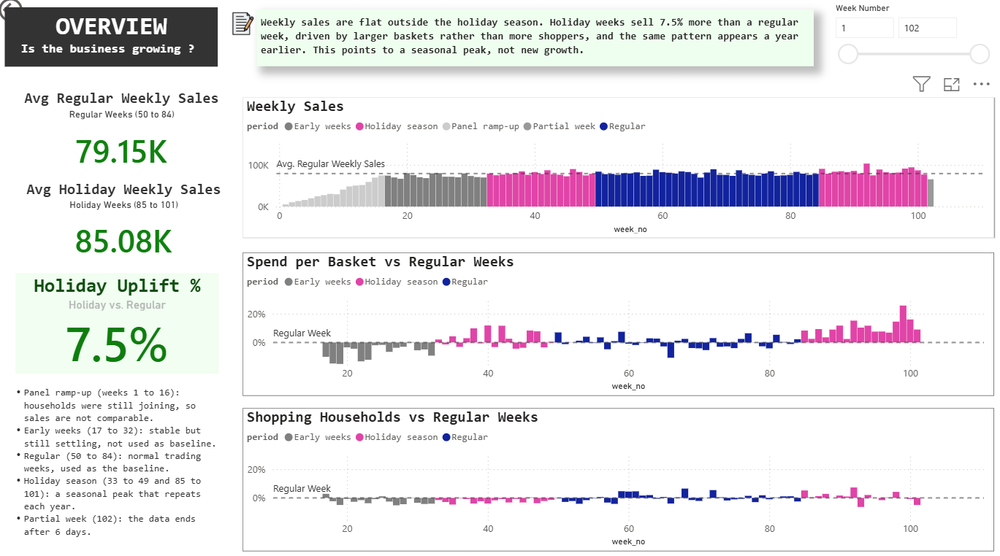
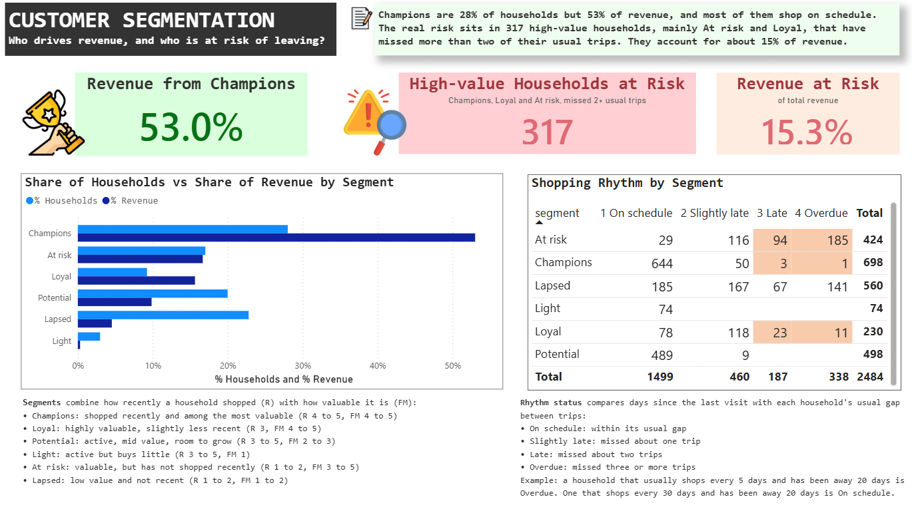
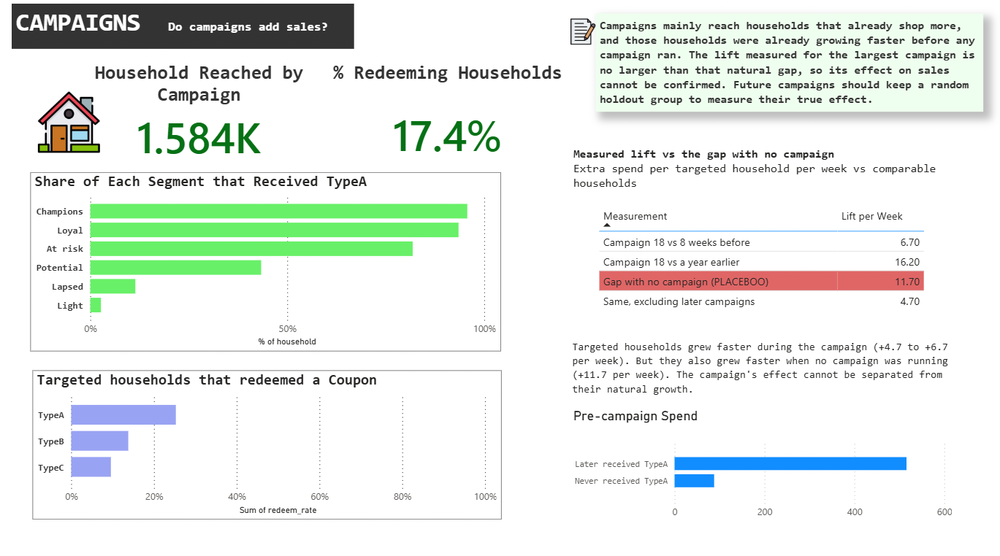
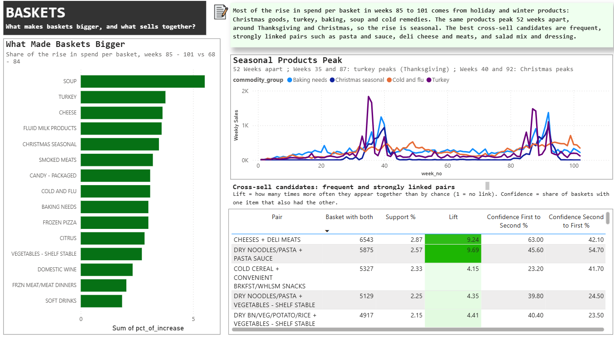

# Dunnhumby Retail Analysis

Hypothetical case: an Insights Analyst at a US supermarket chain looks at customer value,
campaign effectiveness and cross-sell, using two years of purchases from about 2,500 households.

## Executive summary

Sales are flat outside the holiday season. This project asks how to grow that flat base.

**Key findings**
1. **The late rise in sales is seasonal, not growth.** Holiday weeks sell 7.5% more than a regular
   week, driven by bigger baskets, not more shoppers. A similar rise appears a year earlier.
2. **28% of households (Champions) drive 53% of revenue, and most are stable.** The real risk sits
   in 317 to 372 high-value households that have missed more than two of their usual trips,
   worth about 15 to 17% of revenue.
3. **Campaign impact cannot be confirmed.** Targeted households were already growing faster before
   any campaign ran, by as much as the lift measured during the largest campaign.
4. **Bigger baskets are the main sales lever.** Spend per basket explains 77% of weekly sales
   variation. Pasta and sauce, deli cheese and meats, and salad mix and dressing are the
   strongest cross-sell candidates.

**Recommendations**
1. Run a win-back action for the 279 At risk households that are Late or Overdue.
2. Keep a random holdout group in every campaign to measure its true effect.
3. Test cross-sell bundles on the candidate pairs, with a holdout, before rollout.
4. Plan seasonal displays for baking and holiday meal items ahead of Thanksgiving and Christmas.

## Dashboard

Built in Power BI from summary tables in `sql/06_dashboard_tables.sql`. The `.pbix` file is in `dashboard/`.






## Business question

Weekly sales are flat in regular weeks and rise only in the holiday season, so the base is not
growing. We wanted to ask three questions:
1. **Customers (Q1):** which households drive revenue, and which are at risk of leaving?
2. **Campaigns (Q2):** do campaigns add sales beyond what households would buy anyway?
3. **Baskets (Q3):** what makes baskets bigger, and which products sell together?

Full background: [docs/business_case.md](docs/business_case.md)

## Data

- Dunnhumby "The Complete Journey" (Kaggle): 2,595,732 transaction rows, 2,500 households, 102 weeks
- Days and weeks are relative numbers with no calendar dates. 
- Analysis covers merchandise only. Fuel, coupons and other non-merchandise items (8 to 10% of
  sales) are excluded.
- Weeks 1 to 16 are excluded while households were still joining (ramp-up period). Week 102 has only 6 days.
- Demographics cover only 32% of households and are not representative, so they are not used.
- 18,917 rows (0.73%) with zero sales or quantity were excluded or kept only for basket analysis.
  No returns exist in the data.

## How to run

1. Install PostgreSQL and Python, then the Python packages:
   `pip install pandas sqlalchemy "psycopg[binary]"`
2. Create an empty database named `dunnhumby` in pgAdmin.
3. Download the dataset from Kaggle ("Dunnhumby - The Complete Journey") and place the CSV files
   in `data/archive (1)/`.
4. From the project folder, run `python sql/00_load_data.py`. It asks for the postgres password.
5. In pgAdmin, run `sql/01` to `sql/06` in order. Later files use views created by earlier ones.
6. Open `dashboard/dunnhumby.pbix` in Power BI Desktop and click Refresh.
   Update the server and password if prompted.

## Approach

| Step | File | What it does |
|---|---|---|
| Load | `sql/00_load_data.py` | Loads CSV files into PostgreSQL |
| Data quality | `sql/01_data_quality_check.sql` | Row checks, zero values, demographics coverage, clean views |
| EDA | `sql/02_eda.sql` | Weekly trend, product mix, shopping frequency, campaigns ([docs/eda.md](docs/eda.md)) |
| Q1 | `sql/03_rfm_segmentation.sql` | RFM segments and churn risk |
| Q2 | `sql/04_promo_lift.sql` | Sales drivers, campaign lift, placebo test, discounts |
| Q3 | `sql/05_basket_analysis.sql` | Basket value drivers and product pairs |
| Dashboard | `sql/06_dashboard_tables.sql` | Summary tables for Power BI |

Definitions and calculation details: [docs/methods.md](docs/methods.md)

## Findings

### Q1 Customers

Households were scored 1 to 5 on Recency, Frequency and Monetary, then grouped into six segments.
Churn risk compares each household's time since its last trip with its own usual gap between trips,
since shopping rhythms range from every 3 days to every 40 days.

| Segment | Households | Revenue |
|---|---|---|
| Champions | 28% | 53% |
| At risk | 17% | 17% |
| Loyal | 9% | 16% |
| Potential | 20% | 10% |
| Lapsed and Light | 26% | 5% |

- Champions are stable: 92% shop on schedule.
- 317 high-value households (At risk, Loyal, Champions) have missed more than two usual trips,
  worth 1.04M of revenue over 86 weeks (15.3%). Using a median gap instead of an average raises
  this to 372 households and 1.15M (16.8%).
- A third of RFM "At risk" households are within their normal rhythm, so targeting all 424 would
  waste effort.

### Q2 Campaigns

Campaigns overlap continuously from week 33, so targeted households were compared with similar
non-targeted households, measuring each household's change from its own baseline.

- Only 17% of households ever redeemed a coupon. Coupons are 2.4% of all discounts, the rest are
  store discounts.
- Targeting is not random. Before any campaign, households later targeted spent 5.9 times more.

| Comparison | Extra spend per targeted household per week |
|---|---|
| Gap with no campaign running (placebo, weeks 17 to 32) | 11.7 |
| Campaign 18 vs 8 weeks before | 6.7 |
| Campaign 18, excluding later campaigns | 4.7 |

The lift during the largest campaign is no larger than the gap seen with no campaign at all,
so its effect cannot be separated from natural growth. No pull-forward was found: targeted
households did not spend less after the campaign.

### Q3 Baskets

- About half of the rise in spend per basket in weeks 85 to 101 comes from holiday and winter items
  (Christmas goods, turkey, baking, soup, cold remedies), and the same items peak a year earlier.
- Everyday staples are often bought together but only loosely linked (lift 2 to 3).

| Cross-sell candidate | Baskets with both | Lift | Gap |
|---|---|---|---|
| Pasta and pasta sauce | 5,875 | 9.7 | 54% of pasta baskets have no sauce |
| Deli cheese and deli meats | 6,543 | 9.2 | 58% of deli meat baskets have no cheese |
| Salad mix and dressing | 4,012 | 4.3 | 72% of salad mix baskets have no dressing |
| Dinner mixes and shelf-stable meat | 3,789 | 5.5 | 69% of dinner mix baskets have no meat |

Lift shows how many times more often two items appear together than by chance.

## What changed along the way

1. The late-period sales rise first looked like growth. Product data showed it was the holiday
   season, repeating 52 weeks apart.
2. A first estimate said the largest campaign added about 145,000 in sales. A placebo test showed
   targeted households grew just as fast with no campaign, so the effect could not be confirmed.
3. RFM flagged 424 households as At risk. Comparing each household with its own shopping rhythm
   showed a third of them were simply between regular trips.

Working notes: [docs/journey.md](docs/journey.md)

## Limitations

- Observational data. Campaign and cross-sell effects show association, not cause.
- No margin or campaign cost data, so results are in sales, not profit.
- Store discounts (about 18% of sales) were not evaluated, since there is no comparison group.
- The panel of 2,500 households may not represent all store customers.
- Holiday timing is inferred from product patterns, not calendar dates.


## Repository structure

```
dunnhumby-analysis/
├── README.md
├── sql/         load script and SQL files 01 to 06
├── docs/        business_case, eda, methods, journey
├── dashboard/   Power BI file and page images
└── data/        raw CSV files (not included, see How to run)
```
